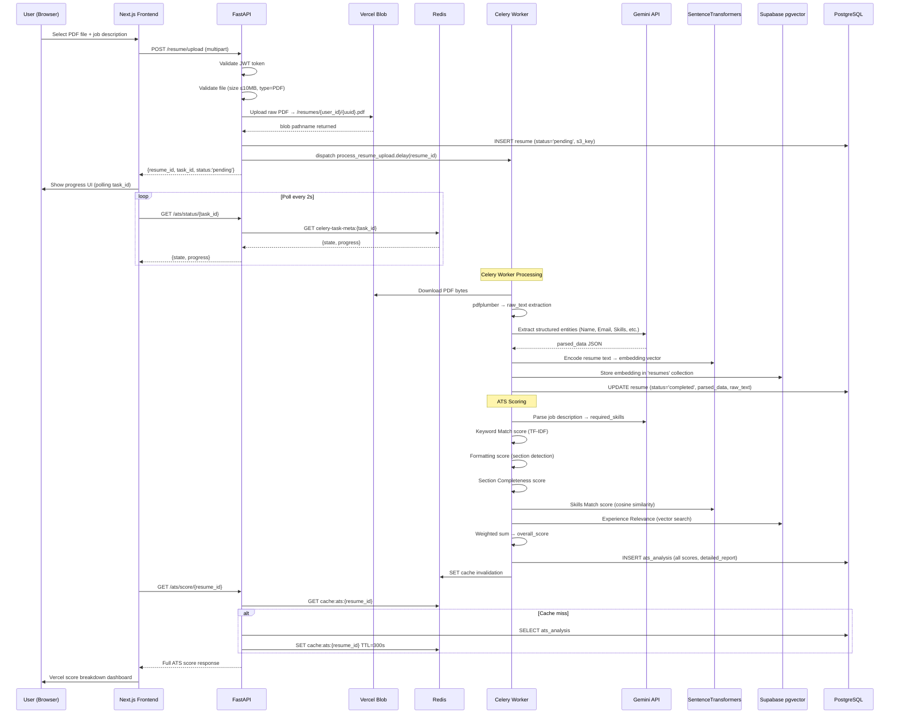
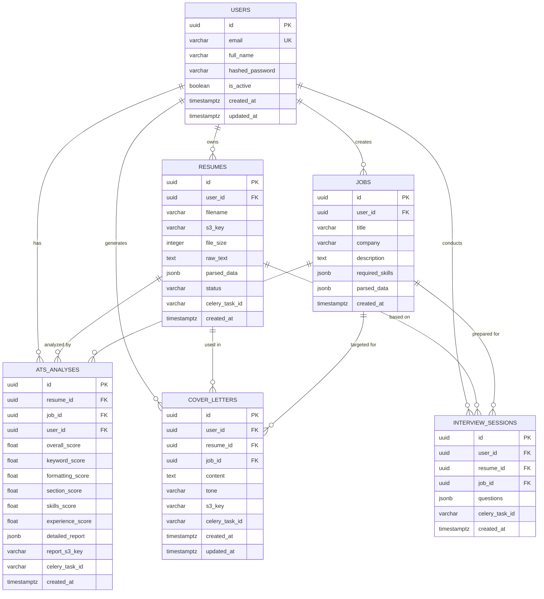
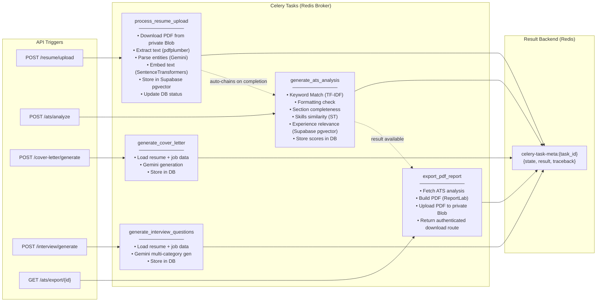
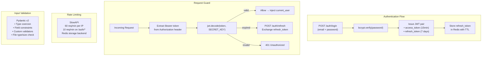
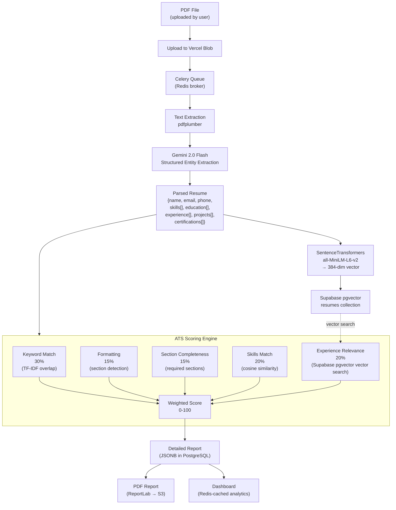

# SmartHire AI — System Architecture

## Table of Contents
1. [System Overview](#1-system-overview)
2. [High-Level Architecture Diagram](#2-high-level-architecture-diagram)
3. [Request Flow — PDF Upload & ATS Analysis](#3-request-flow--pdf-upload--ats-analysis)
4. [Database Entity-Relationship Diagram](#4-database-entity-relationship-diagram)
5. [Celery Task Dependency Graph](#5-celery-task-dependency-graph)
6. [Component Responsibilities](#6-component-responsibilities)
7. [Security Architecture](#7-security-architecture)
8. [Data Flow — AI Pipeline](#8-data-flow--ai-pipeline)

---

## 1. System Overview

SmartHire AI is a multi-tier web application with clearly separated concerns:

| Tier | Technology | Deployment |
|------|-----------|-----------|
| **Frontend** | Next.js 14 (App Router) + TypeScript + TailwindCSS | Vercel |
| **Backend API** | FastAPI (Python 3.11) | Vercel |
| **Task Workers** | Celery 5.4 | Vercel (background worker) |
| **Primary Database** | PostgreSQL | Supabase |
| **Cache + Broker** | Redis 7 | Redis Cloud / Upstash |
| **Vector Database** | pgvector | Vercel (separate service) |
| **File Storage** | Private Vercel Blob | Vercel |
| **AI Models** | Gemini 2.0 Flash + SentenceTransformers (all-MiniLM-L6-v2) | API / Embedded |

---

## 2. High-Level Architecture Diagram

```mermaid
graph TB
    subgraph Client["Client Layer"]
        Browser["Browser\n(Next.js 14 App)"]
    end

    subgraph CDN["CDN / Edge"]
        Vercel["Vercel Edge Network"]
    end

    subgraph API["API Layer (Vercel)"]
        FastAPI["FastAPI Server\n:8000"]
        RateLimiter["SlowAPI Rate Limiter\n(Redis-backed)"]
        JWTMiddleware["JWT Auth Middleware"]
    end

    subgraph Workers["Worker Layer (Vercel)"]
        CeleryWorker["Celery Worker\n(async tasks)"]
        CeleryFlower["Flower Monitor\n:5555"]
    end

    subgraph DataLayer["Data Layer"]
        Postgres["PostgreSQL\n(Supabase)\nPrimary DB"]
        Redis["Redis\nCache + Broker"]
        Supabase pgvector["Supabase pgvector\nVector Store"]
        S3["Private Vercel Blob\nFile Storage"]
    end

    subgraph AILayer["AI Layer"]
        Gemini["Google Gemini\n2.0 Flash API"]
        SentenceTransformers["SentenceTransformers\nall-MiniLM-L6-v2\n(local embedding)"]
    end

    Browser --> Vercel
    Vercel --> FastAPI
    FastAPI --> RateLimiter
    FastAPI --> JWTMiddleware
    FastAPI --> Postgres
    FastAPI --> Redis
    FastAPI --> S3
    FastAPI --> CeleryWorker

    CeleryWorker --> Redis
    CeleryWorker --> Postgres
    CeleryWorker --> S3
    CeleryWorker --> Supabase pgvector
    CeleryWorker --> Gemini
    CeleryWorker --> SentenceTransformers

    FastAPI -.->|query vectors| Supabase pgvector
    CeleryFlower -.->|monitor| CeleryWorker
```

---

## 3. Request Flow — PDF Upload & ATS Analysis



---

## 4. Database Entity-Relationship Diagram



---

## 5. Celery Task Dependency Graph



---

## 6. Component Responsibilities

### FastAPI Backend
- **Auth module**: JWT issuance, validation, refresh, bcrypt hashing
- **Route handlers**: Input validation (Pydantic v2), auth guard, response shaping
- **Rate limiter**: SlowAPI with Redis storage — 60 req/min per user
- **Orchestration**: Dispatch Celery tasks, return task_id for polling
- **Cache layer**: Redis-backed response caching for analytics (5-min TTL)

### Celery Workers
- **Isolation**: All AI-heavy, long-running work runs outside the request cycle
- **Retry policy**: Max 3 retries with exponential backoff on transient failures
- **Progress updates**: Task state updated with custom `UPDATE` state + percentage
- **Concurrency**: 4 worker processes (configurable via `CELERY_CONCURRENCY`)

### Supabase pgvector
- **Collection: `resumes`** — one embedding per resume document
- **Collection: `jobs`** — one embedding per job description
- **Purpose**: Semantic similarity search for Skills Match and Experience Relevance scoring
- **Embedding model**: `all-MiniLM-L6-v2` (384-dim, runs locally in worker)

### Vercel Blob File Layout
```
smarthire-ai-bucket/
├── resumes/
│   └── {user_id}/
│       └── {resume_uuid}.pdf
├── reports/
│   └── {user_id}/
│       └── {analysis_uuid}_report.pdf
└── cover-letters/
    └── {user_id}/
        └── {letter_uuid}.pdf
```

---

## 7. Security Architecture



**Security measures:**
- Passwords hashed with `bcrypt` (12 rounds)
- JWT signed with `HS256`, access token TTL = 15 minutes
- Refresh tokens stored in Redis (invalidated on logout)
- File validation: MIME type must be `application/pdf`, max 10 MB
- All inputs validated by Pydantic v2 before hitting business logic
- CORS restricted to `ALLOWED_ORIGINS` env var
- Private Blob files are streamed through authenticated, ownership-checked API routes

---

## 8. Data Flow — AI Pipeline


